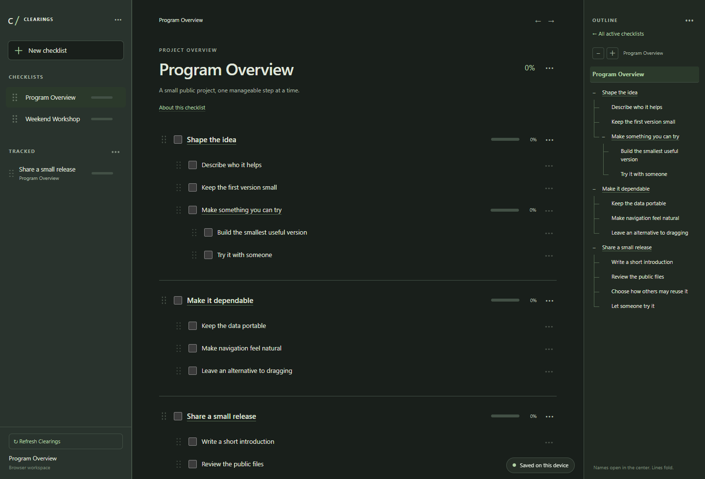

<!--
SPDX-License-Identifier: MIT
MIT License

Copyright (c) 2026 The Hermit

Permission is hereby granted, free of charge, to any person obtaining a copy
of this software and associated documentation files (the "Software"), to deal
in the Software without restriction, including without limitation the rights
to use, copy, modify, merge, publish, distribute, sublicense, and/or sell
copies of the Software, and to permit persons to whom the Software is
furnished to do so, subject to the following conditions:

The above copyright notice and this permission notice shall be included in all
copies or substantial portions of the Software.

THE SOFTWARE IS PROVIDED "AS IS", WITHOUT WARRANTY OF ANY KIND, EXPRESS OR
IMPLIED, INCLUDING BUT NOT LIMITED TO THE WARRANTIES OF MERCHANTABILITY,
FITNESS FOR A PARTICULAR PURPOSE AND NONINFRINGEMENT. IN NO EVENT SHALL THE
AUTHORS OR COPYRIGHT HOLDERS BE LIABLE FOR ANY CLAIM, DAMAGES OR OTHER
LIABILITY, WHETHER IN AN ACTION OF CONTRACT, TORT OR OTHERWISE, ARISING FROM,
OUT OF OR IN CONNECTION WITH THE SOFTWARE OR THE USE OR OTHER DEALINGS IN THE
SOFTWARE.
-->
# Clearings 0.4.7

Clearings is a local checklist and outline for people and their AI collaborators.
This release brings quieter editing, task context for assistants, and easier setup.
Your workspace stays on your device. There is no account, telemetry, bundled AI,
API key, subscription or runtime download. Each item can also hold a Response beneath
Details, so you can leave a thought for yourself or an AI collaborator without
changing its completion criteria.

New here with an assistant? Point it at this folder, or start with the short
[welcome guide](AI_START_HERE.md). It explains how people and AIs can use Clearings
together and links to setup only when you need it.

## New in 0.4.7

Descriptions start folded. Single-click an end-item title to reveal its description;
a parent title expands its children. Double-click a description to edit it, then
use **Add Response** in that editor if needed. The compact **Edit Item** editor
keeps Description prominent, with Response and Review folded. Enter saves, Shift+Enter
adds a line, and Esc cancels/closes. Ctrl+Z / Ctrl+Y undo typing in text fields
and recent human actions elsewhere. AI work is excluded from session Undo, and
newer conflicting edits are preserved. Reloading clears the saved-action history.

The launched source has **Settings → App updates**: automatic daily checks are
on by default, with an off switch and **Check now**. Checks retrieve public GitHub
release information only; they do not send checklist content or local identities.
GitHub receives ordinary connection metadata including IP address. An unavailable
network does not block work. Downloads and installation remain manual. The
standalone HTML remains unable to make network requests and offers a release link.

The optional MCP adapter adds focused revision-checked edits, paged briefings,
connection status, proposal previews and deliberate context handoffs. Agents can
keep working context beneath tasks for themselves or others. Read the
[task context guide](AI_START_HERE.md#saving-context-under-tasks).
Network hosting and cross-device sharing are deferred to a later version.

## Download and open

For a fork or source ZIP, start with [Run Clearings from source](docs/QUICKSTART.md).
One Python command opens the app; `--check` verifies setup without starting it.
See [Contributing](CONTRIBUTING.md) for editing, tests and clean packaging.
Forks choose their own GitHub release source in `clearings.json`, or disable it.

Get the matching file from [Releases](https://github.com/IoriReiMei/clearings/releases).

| Computer | Download | Install |
| --- | --- | --- |
| Windows x64 | `Clearings-Setup-0.4.7-Windows-x64.exe` | Open the installer, choose shortcuts, finish, then open Clearings. No administrator rights or separate Python installation. |
| Mac Apple silicon | `Clearings-0.4.7-macOS-arm64.dmg` | Open the image and drag Clearings into Applications. |
| Mac Intel | `Clearings-0.4.7-macOS-x86_64.dmg` | Open the image and drag Clearings into Applications. |
| Linux x64 | `Clearings-Install-0.4.7-Linux-x64.run` | Run `sh Clearings-Install-0.4.7-Linux-x64.run`, then open Clearings from the app menu. |

The installed app opens your normal browser at `http://127.0.0.1:18765/`.
Windows binaries are unsigned; macOS builds are ad-hoc signed, not notarized.
Your operating system may require an extra launch approval. Signing and
notarization remain future distribution work. Windows
installer upgrades are automated checks; interactive Mac/Linux installation and
Safari still need hands-on testing. See [verification limits](CLEARINGS_VERIFICATION.md).

For an update, save your work and run the new installer into the same program
folder. Windows setup stops that installation's helper before replacing it.
This version updates the host and tray, so allow a brief restart when ongoing
work reaches a stopping point. The working edition and installed edition have
separate browser workspaces; installing is not a workspace migration.

The source ZIP also contains `index.html`, usable directly without installing a
runtime. Direct-file and hosted use support JSON import/export; local assistant
handoff requires the installed helper (or Python for the source launcher).

## Windows tray icon

While its helper runs, Clearings has an icon in the Windows notification area
(possibly under the hidden-icons arrow). **Double-click** it to open Clearings;
**right-click** for local status, **Open Clearings**, **Start helper with Windows**,
and **Stop helper…**. Keyboard activation also opens Clearings.

Windows startup is optional and off until you enable it. It starts this copy's
helper quietly at sign-in, without opening a browser or console. Uncheck the same
tray option to turn it off. It applies to your Windows account; Windows Startup
Apps can independently disable the entry. The working and installed editions keep
their own addresses and settings. See [Windows startup details](docs/LOCAL_HANDOFF.md#windows-tray-and-sign-in-control--047).

Save browser edits before stopping from the tray. Closing a browser tab leaves
the helper and icon running; stopping the helper removes the icon. Mac and Linux
keep their existing launch behavior.
The Windows tray, app shortcuts, setup and uninstaller use size variants of the
same owner-supplied mark shown in the page header.

## Work together

Changes inside a group now mark its ancestors with a **CHANGES INSIDE** count,
including collapsed groups, tracked shortcuts and the outline. Shared items
count once per group. Clear indicators, Undo and Mark indicator as seen affect
notifications without changing checkmarks. Long groups load in bounded pages
so other work stays reachable.

Create a workspace, choose your display name, and add checklists. Click titles
to explore or fold groups; click checkboxes to complete work. Parent closure does
not claim that all its children were completed. Use **Move to…** to move an item
under another heading or back to the overview. The item keeps its identity,
subtasks, checkmark and attribution. Menus, grips and keyboard controls also
reorder siblings. Shared items remain one object wherever linked.

A group's **⋯ → Collapse all / Expand all** folds or unfolds that group and
its nested groups. In a focused group, it affects the groups underneath the
title. Folding leaves checkmarks, attribution and unread indicators alone;
the outline keeps its own fold controls. These center folds last for the
current page session.

A checked item shows its completer. **Created / completed by…** shows names and
timestamps; Shift reveals additional edit labels. Creator and completer records
survive moves and exports. Missing older history is shown as unknown.

Point your assistant at this source folder: [AGENTS.md](AGENTS.md) leads to a
short [welcome guide](AI_START_HERE.md), with topics for collaboration, helping
a human and handing work to another AI. Connected clients can ask for the same
guidance through `clearings_get_guide`. The [assistant reference](AI_CHECKLIST_GUIDE.md)
has the exact data and command contracts. Your assistant can
read, propose and sign task changes; another assistant can read and continue
those changes immediately, even on a newly created checklist. You do not have to
relay them. **Refresh Clearings** brings signed work into your visible browser
copy. Independent edits combine; conflicts stay visible for review. Assistants
still need their ordinary execution environment and user authorization: Clearings
does not launch models or run tasks on its own. Names identify declared authors,
not verified identities.

An optional [local MCP source connector](docs/CLEARINGS_MCP.md) gives compatible
assistants a checklist search and signed handoff through the same local Bridge.
It needs a separately installed Python MCP SDK and explicit client setup. The
native installers do not bundle the optional Python MCP SDK or enable this connector.

The workspace menu contains **Settings**, **Preferences**, **Recent actions**,
**Export workspace backup…**, and **Save and quit Clearings**. Templates provide
blank GitHub release and patch checklists; they never publish anything.
**Save and quit** waits for browser saving and the local handoff before stopping
the helper. If saving needs attention, it keeps Clearings open with an explanation.

## Keep your work

Local-helper sessions are protected for your account. The public loopback page
does not expose a reusable helper credential. The helper preserves recovery
metadata when replacing a stale session, and larger aggregate handoffs have a
64 MiB limit. Individual JSON documents and browser workspaces keep their own
limits. Resolved proposal history can be archived explicitly through the CLI;
pending work is retained.

Ordinary changes save to this browser's IndexedDB. The helper keeps a saved local
handoff plus pending signed work. Export a backup regularly. A different browser,
profile, file path or address has separate browser storage: export from the old
location and import once at the new one. Never discard the old copy before
checking the new one. Working edition port 8765 and installed edition port 18765
are deliberately separate. Uninstall removes the program, not your work.

Version 0.4.3 reads older documents. Its optional attribution field requires
0.4.3 or newer when importing a new export into another Clearings copy.

## Feedback

[Report a problem or suggest an improvement](https://github.com/IoriReiMei/clearings/issues).
Include the Clearings version, operating system, browser, steps and expected
result. Use a small fictional checklist to reproduce a problem; keep personal
workspace exports, helper session files and access tokens out of public reports.

## Development and license

See [local handoff](docs/LOCAL_HANDOFF.md), [installer build notes](packaging/README.md),
[real-browser check](docs/NATIVE_SMOKE_TEST.md), and [hosting](docs/HOSTING.md).
Only reviewed, allowlisted source and fictional examples enter release packages.
The app and designated files use the MIT License; see [license](LICENSE),
[scope](LICENSE_SCOPE.md), and [third-party notes](THIRD_PARTY_NOTES.md).
